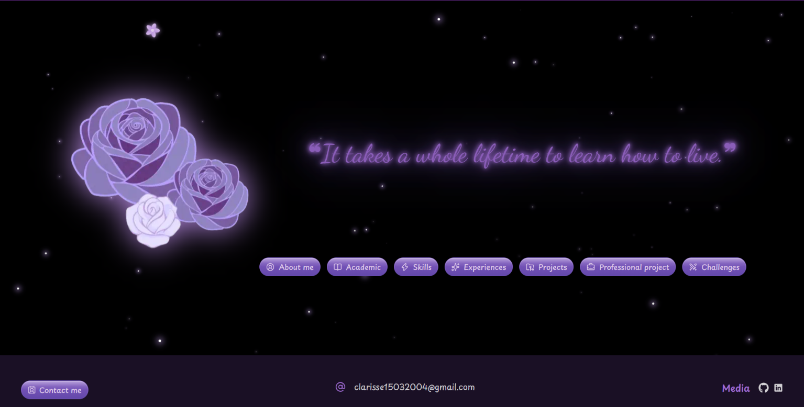

# 🌸 Port-Folio — Clarisse Del Castillo

🔗 **Live site / Site en ligne : [add the Vercel link / lien Vercel à ajouter](https://)**

**🇬🇧 [English](#english)** · **🇫🇷 [Français](#francais)**

---

## 📸 Demo / Démo


<!-- | Desktop / Ordinateur | Tablet / Tablette | Mobile / Téléphone |
| :---: | :---: | :---: |
|  |  |  | -->

| Desktop / Ordinateur | 
| :---: | 
|  | 

**Video**

<video src="./demo-generator/demo.mp4" autoplay loop muted playsinline width="100%"></video>

---

<a id="english"></a>

# 🇬🇧 English

My personal portfolio: a **React 19 + TypeScript** web app presenting my background, skills, experience and projects in a lilac, starry, flowery universe.

## 🎯 Why this project?

More than an online résumé, this portfolio is above all a **learning playground**. I wanted to:

- **learn how to code animations**: CSS keyframes, transitions, animated SVG paths, neon effects;
- **try my hand at 3D in the browser** with [React Three Fiber](https://r3f.docs.pmnd.rs/) and [Drei](https://drei.docs.pmnd.rs/);
- **polish the user experience** with sound, a custom cursor and micro-interactions;
- make everything **responsive** on desktop, tablet and mobile.

## ✨ Features

### 🧊 3D with React Three Fiber
- **Home page**: a flower image mapped onto a 3D plane that gently floats and tilts as the mouse moves (parallax effect).
- **Skills page**: my skills sit on the vertices of translucent glass **3D crystals** (tetrahedron, octahedrons, icosahedron) that slowly rotate.
  - Clicking a skill freezes the crystal, blurs the rest of the screen and opens a details panel linked to the crystal by a glowing line.
  - All scenes share **a single WebGL Canvas** thanks to Drei's `View`, which saves resources. Rendering pauses when the section is off-screen.

### 🎞️ Animations
- **Starry sky**: 80 small twinkling crystals randomly generated in the background.
- **Pulsing neon quote** on the home page.
- **Flower path** (Academic page): an SVG curve that progressively draws itself in a zigzag, then flowers bloom one by one along it.
- **Slide-in entrances** for cards (left, right, top, bottom).
- **Glossy buttons** with a light sheen sweeping across them on hover.
- **Profile picture** clipped into a flower shape with a neon outline.

### 🖱️ Custom cursor
The mouse cursor is replaced by a **small spinning flower**. It follows the pointer with a slight trailing effect and grows and glows when hovering clickable elements. It is only enabled on devices with a mouse or trackpad: touch screens keep their normal behaviour.

### 🔊 Sound
- **Background music**, started on the first click or key press (browsers block autoplay).
- **Click sound effect** on buttons, played through the **Web Audio API**: the sound is loaded once and cached for instant playback.

### 📬 Contact form
A form in a modal lets visitors send me a message directly from the site with **EmailJS**, no server required.

### 📱 Responsive
- A slide-in burger menu on mobile, a fixed footer on desktop.
- Layouts adapted to every screen size (phone, tablet in portrait and landscape, desktop).
- `dvh` units to correctly handle the address bar of mobile browsers.

## 🛠️ Tech stack

| Category | Tools |
| --- | --- |
| Framework | React 19, TypeScript, Vite |
| Styling | Tailwind CSS v4, shadcn/ui (Radix), tw-animate-css |
| 3D | Three.js, React Three Fiber, Drei |
| Routing | React Router |
| Icons | lucide-react, react-icons, Hugeicons |
| Fonts | Fontsource (Dancing Script, Playpen Sans, Figtree) |
| Contact | EmailJS |
| Sound | Web Audio API, `<audio>` element |
| Hosting | Vercel |

## 🚀 Getting started

### Prerequisites
- [Node.js](https://nodejs.org/) (version 20 or later recommended)
- npm

### Installation

```bash
git clone https://github.com/dev-Clarisse/Port-Folio.git
cd Port-Folio
npm install
```

### Environment variables

The contact form needs EmailJS credentials. Create a `.env` file at the project root:

```env
VITE_EMAILJS_SERVICE_ID=your_service_id
VITE_EMAILJS_TEMPLATE_ID=your_template_id
VITE_EMAILJS_PUBLIC_KEY=your_public_key
```

> Without these variables the site still works; only sending messages fails.

### Scripts

| Command | Purpose |
| --- | --- |
| `npm run dev` | Starts the dev server at [http://localhost:5173](http://localhost:5173) |
| `npm run build` | Type-checks, then builds the production version into `dist/` |
| `npm run preview` | Serves the production build locally |
| `npm run lint` | Lints the code with ESLint |

## 📲 Testing on a phone with ngrok

To check the result on a real phone during development, I use [ngrok](https://ngrok.com/), which creates a public URL pointing to my local server:

```bash
# 1. Start the dev server
npm run dev

# 2. In another terminal, open a tunnel to Vite's port
.\ngrok http 5173
```

Then simply open the `https://….ngrok-free.dev` URL shown by ngrok on your phone.

> By default Vite blocks unknown hostnames: the ngrok domain must be added to `server.allowedHosts` in [`vite.config.ts`](vite.config.ts).

## ☁️ Deploying to Vercel

The site is hosted on **Vercel**. To deploy a new production version:

```bash
npx vercel login
npx vercel --prod
```

The EmailJS environment variables must also be set in the project settings on Vercel.

## 🗂️ Project structure

```
port-folio/
├── public/
│   ├── pdfs/                  # Internship reports and certificates
│   └── sounds/                # Background music and click sound
├── src/
│   ├── assets/                # Images (flowers, profile picture…)
│   ├── components/
│   │   ├── 3D/
│   │   │   ├── CrystalScene.tsx   # Interactive 3D crystals (Skills page)
│   │   │   └── FlowersGL.tsx      # Floating 3D flowers (home page)
│   │   ├── Box/
│   │   │   └── FlowerBoxMe.tsx    # Flower-shaped profile picture
│   │   ├── Form/
│   │   │   └── ContactDialog.tsx  # Contact form (EmailJS)
│   │   ├── layout/
│   │   │   ├── BackButton/        # Back-to-home button
│   │   │   ├── Background/        # Animated starry sky
│   │   │   ├── Cursor/            # Custom flower cursor
│   │   │   ├── FlowerPath/        # Animated SVG path with blooming flowers
│   │   │   ├── Footer/            # Footer (desktop)
│   │   │   └── MobileMenu/        # Burger menu (mobile)
│   │   ├── sections/              # One page per portfolio section
│   │   │   ├── Home/
│   │   │   ├── AboutMe/
│   │   │   ├── Academic/
│   │   │   ├── Skills/
│   │   │   ├── Experiences/
│   │   │   ├── Projects/
│   │   │   ├── ProfessionnalProject/
│   │   │   └── Challenges/
│   │   └── ui/                    # shadcn/ui components (button, dialog, accordion)
│   ├── data/
│   │   └── navItems.ts            # Shared navigation links
│   ├── Hooks/
│   │   ├── Sound.ts               # Sound playback with the Web Audio API
│   │   └── ScrollLock.ts          # Scroll lock on large screens
│   ├── lib/
│   │   └── utils.ts               # Utility functions
│   ├── App.tsx                    # Global layout, routes and background music
│   ├── App.css                    # Global styles and animations
│   ├── index.css                  # Tailwind theme, palette, fonts, keyframes
│   └── main.tsx                   # Entry point
├── index.html
├── vite.config.ts
└── package.json
```

Each page is **lazy-loaded** (`React.lazy`), so the first load stays fast despite the weight of the 3D libraries.

## 🚧 Work in progress

- [ ] **Professional project** page
- [ ] **Challenges** page

## 🎨 Credits

- **Palette**: "Pastel Lavender" on [Coolors](https://coolors.co/)
- **Fonts**: [Fontsource](https://fontsource.org/)
- **Sounds**: [Pixabay](https://pixabay.com/)
- **Images**: made with [Canva](https://www.canva.com/), backgrounds removed with [remove.bg](https://www.remove.bg/), converted to WebP

## 👩‍💻 Contact

**Clarisse Del Castillo**, 5th-year student at EPF (Digital and Intelligent Systems)

- 💼 [LinkedIn](https://linkedin.com/in/clarisse-del-castillo)
- 🐙 [GitHub](https://github.com/dev-Clarisse)
- ✉️ clarisse15032004@gmail.com

---

<a id="francais"></a>

# 🇫🇷 Français

Mon portfolio personnel : une application web en **React 19 + TypeScript** pour présenter mon parcours, mes compétences, mes expériences et mes projets, dans un univers lilas, étoilé et fleuri.

## 🎯 Pourquoi ce projet ?

Au-delà d'un simple CV en ligne, ce portfolio est avant tout un **terrain d'apprentissage**. J'ai voulu :

- **apprendre à coder des animations** : keyframes CSS, transitions, tracés SVG animés, effets néon ;
- **m'essayer à la 3D dans le navigateur** avec [React Three Fiber](https://r3f.docs.pmnd.rs/) et [Drei](https://drei.docs.pmnd.rs/) ;
- **soigner l'expérience utilisateur** avec du son, un curseur personnalisé et des micro-interactions ;
- rendre le tout **responsive** sur ordinateur, tablette et téléphone.

## ✨ Fonctionnalités

### 🧊 3D avec React Three Fiber
- **Page d'accueil** : une image de fleurs plaquée sur un plan 3D qui flotte doucement et s'incline en suivant la souris (effet parallaxe).
- **Page Skills** : mes compétences sont réparties sur les sommets de **cristaux 3D** (tétraèdre, octaèdres, icosaèdre) en verre translucide qui tournent sur eux-mêmes.
  - Un clic sur une compétence fige le cristal, floute le reste de l'écran et ouvre une fenêtre de détails reliée au cristal par une ligne lumineuse.
  - Toutes les scènes partagent **un seul Canvas WebGL** grâce aux `View` de Drei, ce qui économise les ressources. L'animation se met en pause quand la section n'est plus visible.

### 🎞️ Animations
- **Ciel étoilé** : 80 petits cristaux scintillants générés aléatoirement en arrière-plan.
- **Citation néon** qui pulse sur la page d'accueil.
- **Chemin fleuri** (page Academic) : une courbe SVG qui se dessine progressivement en zigzag, puis des fleurs qui éclosent une à une le long du tracé.
- **Entrées glissées** des cartes (gauche, droite, haut, bas).
- **Boutons « glossy »** avec un reflet lumineux qui balaie le bouton au survol.
- **Photo de profil** découpée en forme de fleur avec un contour néon.

### 🖱️ Curseur personnalisé
Le curseur de la souris est remplacé par une **petite fleur qui tourne**. Elle suit le pointeur avec un léger effet de traînée et grossit en brillant au survol des éléments cliquables. Elle n'est activée que sur les appareils équipés d'une souris ou d'un trackpad : sur écran tactile, le comportement reste normal.

### 🔊 Son
- **Musique d'ambiance** en fond, lancée au premier clic ou à la première touche (les navigateurs bloquent la lecture automatique).
- **Bruitage de clic** sur les boutons, joué via la **Web Audio API** : le son est chargé une seule fois puis mis en cache pour une lecture instantanée.

### 📬 Formulaire de contact
Un formulaire dans une fenêtre modale permet de m'envoyer un message directement depuis le site grâce à **EmailJS**, sans serveur.

### 📱 Responsive
- Un menu burger latéral sur mobile, un footer fixe sur ordinateur.
- Des mises en page adaptées à chaque taille d'écran (téléphone, tablette en portrait et en paysage, ordinateur).
- Unités `dvh` pour gérer correctement la barre d'adresse des navigateurs mobiles.

## 🛠️ Stack technique

| Catégorie | Outils |
| --- | --- |
| Framework | React 19, TypeScript, Vite |
| Style | Tailwind CSS v4, shadcn/ui (Radix), tw-animate-css |
| 3D | Three.js, React Three Fiber, Drei |
| Navigation | React Router |
| Icônes | lucide-react, react-icons, Hugeicons |
| Polices | Fontsource (Dancing Script, Playpen Sans, Figtree) |
| Contact | EmailJS |
| Son | Web Audio API, élément `<audio>` |
| Hébergement | Vercel |

## 🚀 Lancer le projet

### Prérequis
- [Node.js](https://nodejs.org/) (version 20 ou plus récente recommandée)
- npm

### Installation

```bash
git clone https://github.com/dev-Clarisse/Port-Folio.git
cd Port-Folio
npm install
```

### Variables d'environnement

Le formulaire de contact a besoin des identifiants EmailJS. Crée un fichier `.env` à la racine :

```env
VITE_EMAILJS_SERVICE_ID=ton_service_id
VITE_EMAILJS_TEMPLATE_ID=ton_template_id
VITE_EMAILJS_PUBLIC_KEY=ta_cle_publique
```

> Sans ces variables, le site fonctionne, seul l'envoi de message échoue.

### Commandes

| Commande | Rôle |
| --- | --- |
| `npm run dev` | Lance le serveur de développement sur [http://localhost:5173](http://localhost:5173) |
| `npm run build` | Vérifie les types puis génère la version de production dans `dist/` |
| `npm run preview` | Sert la version de production en local |
| `npm run lint` | Analyse le code avec ESLint |

## 📲 Tester sur téléphone avec ngrok

Pour voir le rendu sur un vrai téléphone pendant le développement, j'utilise [ngrok](https://ngrok.com/), qui crée une URL publique pointant vers mon serveur local :

```bash
# 1. Lancer le serveur de développement
npm run dev

# 2. Dans un autre terminal, ouvrir le tunnel vers le port de Vite
.\ngrok http 5173
```

Il suffit ensuite d'ouvrir l'URL `https://….ngrok-free.dev` affichée par ngrok sur son téléphone.

> Vite bloque par défaut les noms de domaine inconnus : le domaine ngrok doit être ajouté dans `server.allowedHosts` de [`vite.config.ts`](vite.config.ts).

## ☁️ Déploiement sur Vercel

Le site est hébergé sur **Vercel**. Pour déployer une nouvelle version en production :

```bash
npx vercel login
npx vercel --prod
```

Les variables d'environnement EmailJS doivent aussi être renseignées dans les paramètres du projet sur Vercel.

## 🗂️ Architecture du projet

```
port-folio/
├── public/
│   ├── pdfs/                  # Rapports de stage et certifications
│   └── sounds/                # Musique d'ambiance et bruitage de clic
├── src/
│   ├── assets/                # Images (fleurs, photo de profil…)
│   ├── components/
│   │   ├── 3D/
│   │   │   ├── CrystalScene.tsx   # Cristaux 3D interactifs de la page Skills
│   │   │   └── FlowersGL.tsx      # Fleurs 3D flottantes de l'accueil
│   │   ├── Box/
│   │   │   └── FlowerBoxMe.tsx    # Photo découpée en forme de fleur
│   │   ├── Form/
│   │   │   └── ContactDialog.tsx  # Formulaire de contact (EmailJS)
│   │   ├── layout/
│   │   │   ├── BackButton/        # Bouton de retour à l'accueil
│   │   │   ├── Background/        # Ciel étoilé animé
│   │   │   ├── Cursor/            # Curseur fleur personnalisé
│   │   │   ├── FlowerPath/        # Chemin SVG animé avec fleurs qui éclosent
│   │   │   ├── Footer/            # Footer (ordinateur)
│   │   │   └── MobileMenu/        # Menu burger (mobile)
│   │   ├── sections/              # Une page par section du portfolio
│   │   │   ├── Home/
│   │   │   ├── AboutMe/
│   │   │   ├── Academic/
│   │   │   ├── Skills/
│   │   │   ├── Experiences/
│   │   │   ├── Projects/
│   │   │   ├── ProfessionnalProject/
│   │   │   └── Challenges/
│   │   └── ui/                    # Composants shadcn/ui (button, dialog, accordion)
│   ├── data/
│   │   └── navItems.ts            # Liens de navigation partagés
│   ├── Hooks/
│   │   ├── Sound.ts               # Lecture de sons via la Web Audio API
│   │   └── ScrollLock.ts          # Blocage du scroll sur les grands écrans
│   ├── lib/
│   │   └── utils.ts               # Fonctions utilitaires
│   ├── App.tsx                    # Mise en page globale, routes et musique de fond
│   ├── App.css                    # Styles globaux et animations
│   ├── index.css                  # Thème Tailwind, palette, polices, keyframes
│   └── main.tsx                   # Point d'entrée
├── index.html
├── vite.config.ts
└── package.json
```

Chaque page est chargée **à la demande** (`React.lazy`) : le premier affichage reste rapide malgré le poids des bibliothèques 3D.

## 🚧 En cours

- [ ] Page **Professional project**
- [ ] Page **Challenges**

## 🎨 Crédits

- **Palette** : « Pastel Lavender » sur [Coolors](https://coolors.co/)
- **Polices** : [Fontsource](https://fontsource.org/)
- **Sons** : [Pixabay](https://pixabay.com/)
- **Images** : créées sur [Canva](https://www.canva.com/), fonds retirés avec [remove.bg](https://www.remove.bg/), converties en WebP

## 👩‍💻 Contact

**Clarisse Del Castillo**, étudiante en 5ᵉ année à l'EPF (Systèmes numériques et intelligents)

- 💼 [LinkedIn](https://linkedin.com/in/clarisse-del-castillo)
- 🐙 [GitHub](https://github.com/dev-Clarisse)
- ✉️ clarisse15032004@gmail.com
